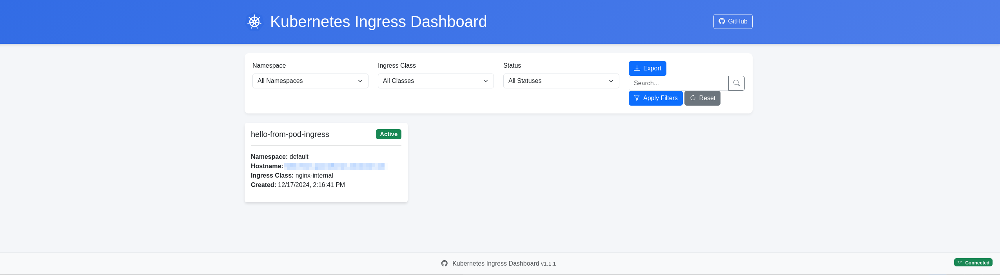
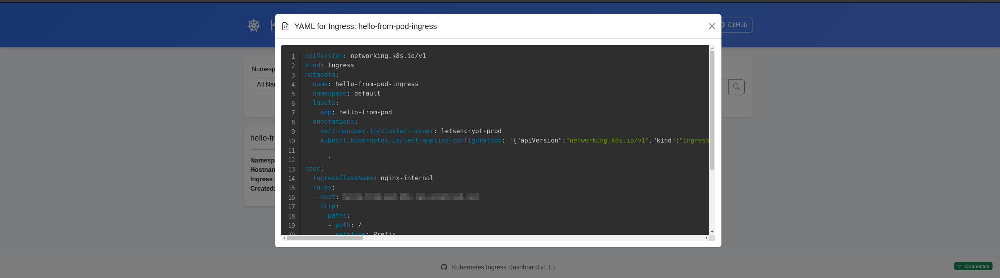

# 🌐 Kubernetes Ingress Dashboard

## 🚀 Overview

Kubernetes Ingress Dashboard is a modern, lightweight web application designed to provide real-time visualization of Ingress resources across Kubernetes clusters. Built with Python, Flask, and Gunicorn, this tool offers an intuitive and responsive interface for monitoring and exploring network configurations.

## 🖼️ Screenshots

Main dashboard:


Clickable card that shows YAML details:



## 🌟 Key Features

### 🔍 Comprehensive Ingress Insights
- Real-time display of all Ingress resources
- Detailed resource information
- Multi-namespace support

### 💻 Technical Highlights
- Responsive HTML5 design
- Gunicorn WSGI server
- Kubernetes Python Client integration
- Docker and Kubernetes deployable

### 🛡️ Enterprise-Ready Characteristics
- Minimal RBAC permissions
- Health check endpoints
- Configurable worker settings

## 🔧 Technologies


## 📊 Dashboard Features

- Hostname display with clickable links
- Ingress class identification
- Resource status indicators
- Namespace-level filtering
- Responsive grid layout

## 🚀 Deployment Options

### Docker
```bash
docker build -t ingress-dashboard:latest .
docker run -p 5000:5000 ingress-dashboard
```

Configure refresh interval (seconds):

```bash
docker run -p 5000:5000 -e REFRESH_INTERVAL_SECONDS=15 ingress-dashboard
```

### Kubernetes

```bash
kubectl apply -f k8s-deployment.yaml
kubectl port-forward svc/ingress-dashboard -p 8080:80
chromium http://localhost:8080
```

`REFRESH_INTERVAL_SECONDS` defaults to `30` and has a minimum value of `5`.
